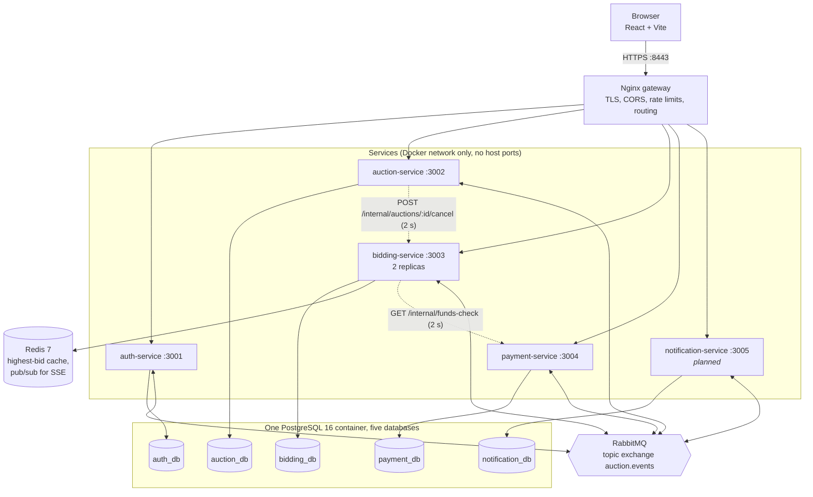
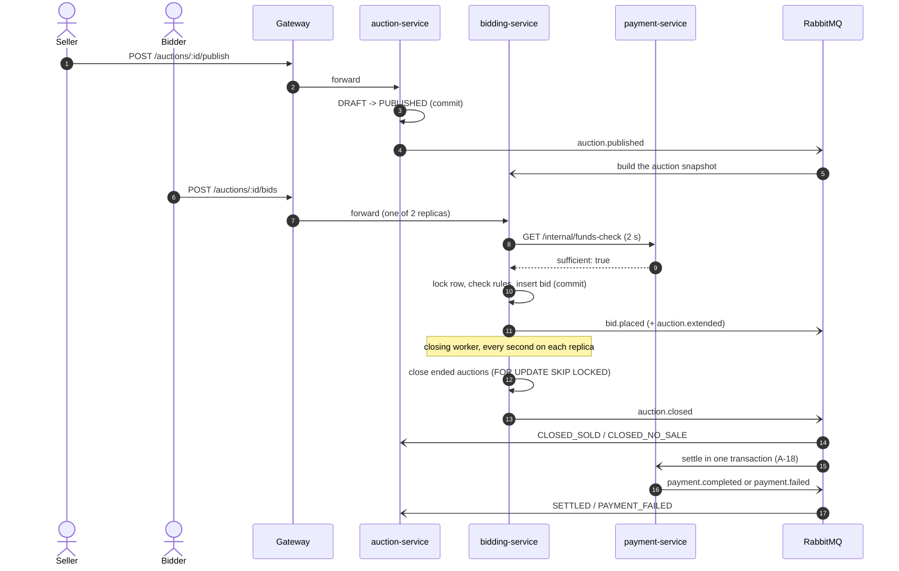
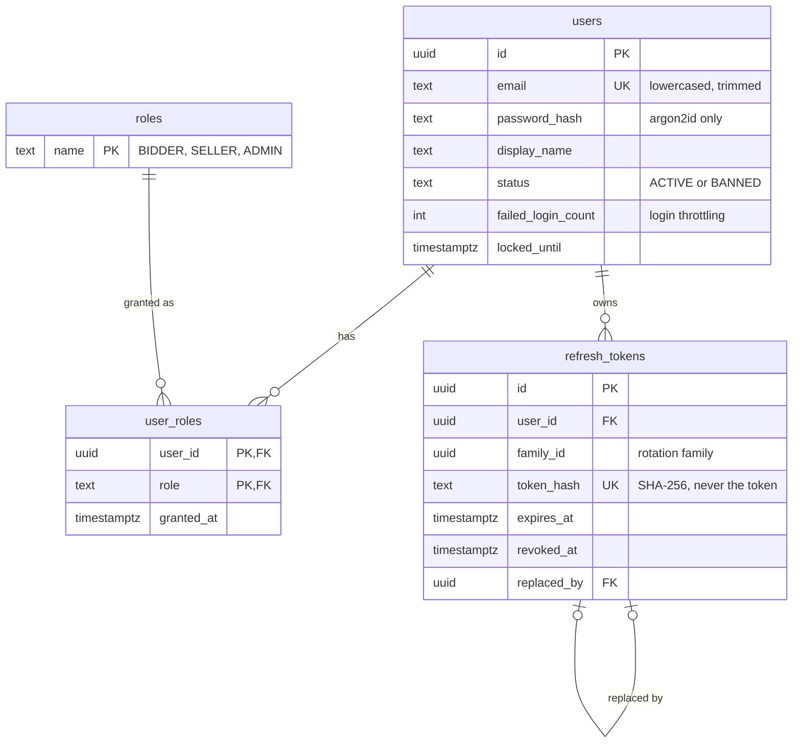
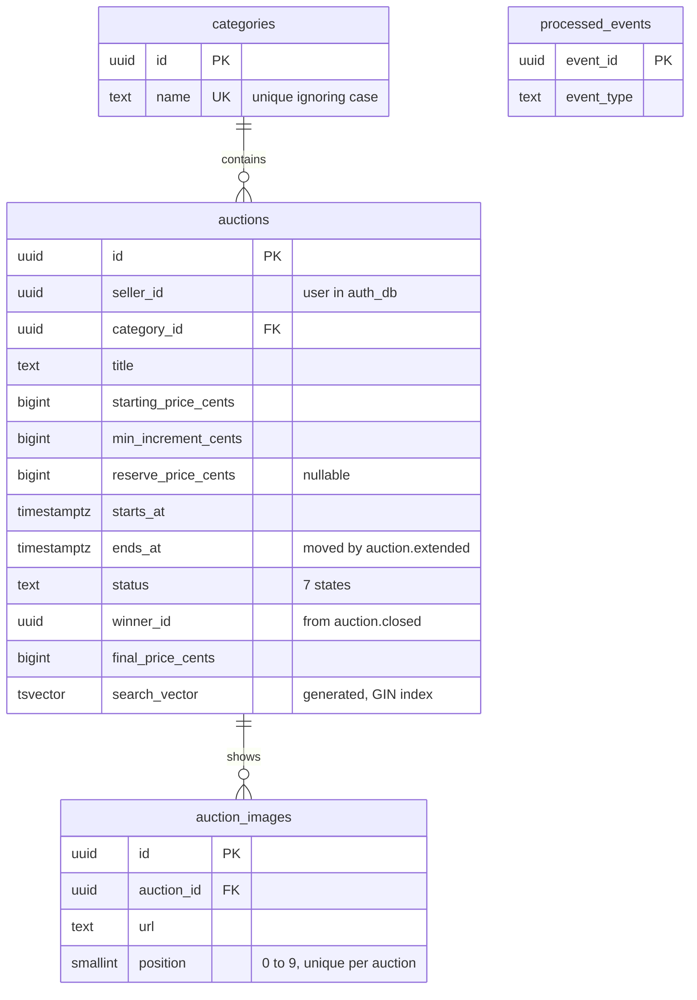
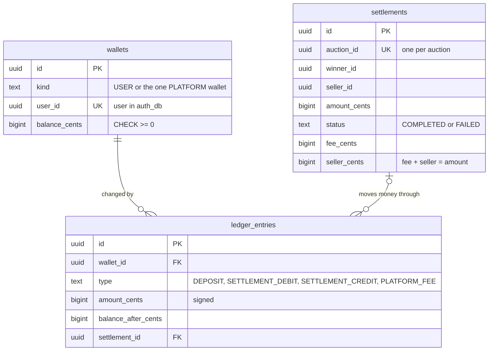
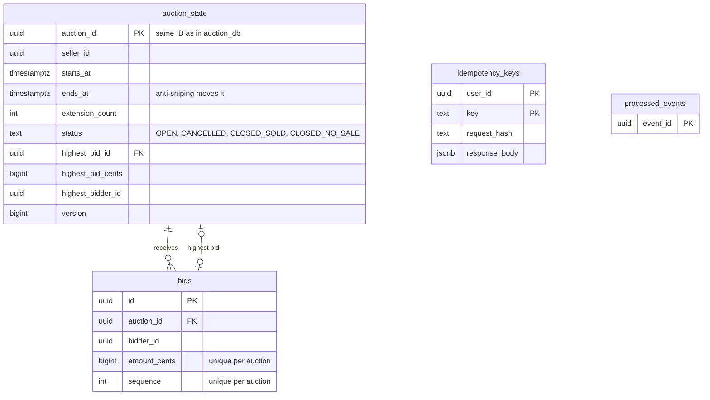

# Architecture

Owner: Erona (task A-03). This document explains how the platform is split into services, how they
talk to each other, where each piece of data lives, and why we chose this design. The rules it
describes come from `ROADMAP.md` §3 and §4, `docs/requirements.md` and `docs/events.md`. If this
document and the code disagree, the code is right and this document must be fixed.

Status on 06.11.2026: auth-service, auction-service, payment-service (wallet part) and the gateway
run on `development`. bidding-service is on Anesa's branches (B-04 to B-11), notification-service
is not built yet (B-14). Parts that do not exist yet are marked _planned_.

## 1. Components

Solid lines are requests. Dotted lines are the only two synchronous calls between services. Every
other interaction between services goes through RabbitMQ.

| Component               | Owner | Responsibility                                                                             | Its data                                                                        |
| ----------------------- | ----- | ------------------------------------------------------------------------------------------ | ------------------------------------------------------------------------------- |
| Nginx gateway           | Erona | The only entry point: TLS, CORS allow-list, rate limits, path routing, blocks `/internal`  | none                                                                            |
| auth-service            | Erona | Register, login, refresh, logout, profile, admin user management, login throttling         | `auth_db`: users, roles, refresh tokens                                         |
| auction-service         | Erona | Catalog, search, categories, auction lifecycle and its status                              | `auction_db`: categories, auctions, images                                      |
| bidding-service         | Anesa | Place bid, bid history, anti-sniping, closing worker, SSE stream (_planned_, B-12)         | `bidding_db`: auction snapshot, bids, idempotency keys; Redis (_planned_, B-09) |
| payment-service         | Erona | Wallets, simulated deposits, funds check, settlement (A-18)                                | `payment_db`: wallets, ledger, settlements                                      |
| notification-service    | Anesa | In-app notifications built from events (_planned_, B-14)                                   | `notification_db` (_planned_)                                                   |
| `backend/shared/common` | Anesa | Logger, error classes and handler, correlation IDs, event contract, publisher and consumer | none                                                                            |
| `backend/shared/auth`   | Erona | JWT verification, `authenticate`, `requireRole`                                            | none                                                                            |

## 2. Service boundaries

A boundary is drawn around data that changes together and a single team member who owns it. Each
service is the only writer of its own database; nothing else reads it.

- **Auction vs bidding.** auction-service owns what an auction _is_ (title, terms, status shown in
  the catalog). bidding-service owns what is _happening_ to it right now (highest bid, extended end
  time, closing). Bids are frequent and need row locks, so they must not wait for the catalog, and
  the catalog must not slow bidding down. Edits are allowed only in `DRAFT`, so bidding's copy of the
  terms (`auction.published`) can never go stale.
- **Payment.** Money has the strictest rules (one transaction per settlement, a ledger row for every
  change), so it is isolated in its own service and database.
- **Notifications** only react to events and never change another service's state, so they can be
  slow or down without affecting bids or payments.
- **Rules that span two databases** are decided by one owner. "A seller may cancel only before the
  first bid" needs auction data and bid data, so auction-service asks bidding-service, which decides
  under the same row lock as place-bid (`docs/events.md` §8).

Every service has the same layers, so a reader always knows where to look:

| Layer        | Folder             | Allowed to                                                              |
| ------------ | ------------------ | ----------------------------------------------------------------------- |
| Routes       | `src/routes`       | Map URLs to controllers and attach `authenticate` / `requireRole`       |
| Controllers  | `src/controllers`  | Validate input with zod, call a service, shape the JSON answer          |
| Services     | `src/services`     | Business rules, ownership checks, state transitions. No Express, no SQL |
| Repositories | `src/repositories` | The only place with SQL, always with `$1` parameters                    |
| Events       | `src/events`       | Map consumed events to service methods                                  |

## 3. Synchronous and asynchronous communication

**Rule:** a service calls another one directly only when the user is waiting for an answer that
only the other service can give. Everything else is an event.

### Synchronous calls

| Caller → callee   | Call                                           | Why it must be synchronous                                                                 | Timeout and failure                                                                                    |
| ----------------- | ---------------------------------------------- | ------------------------------------------------------------------------------------------ | ------------------------------------------------------------------------------------------------------ |
| auction → bidding | `POST /internal/auctions/:id/cancel`           | The seller must know now whether the cancel worked, and only bidding knows if a bid exists | 2 s; `503`, nothing changes. Made before auction's transaction, so no row lock is held during the call |
| bidding → payment | `GET /internal/funds-check?userId&amountCents` | The bidder must know now whether the bid is accepted (decision Q10)                        | 2 s; `503`. Made before bidding's transaction, for the same reason                                     |

`/internal/*` is never routed by the gateway (tested in `tests/e2e/gateway-smoke.mjs`), so only
containers on the Docker network can reach these endpoints.

### Asynchronous events

RabbitMQ topic exchange `auction.events`. The routing keys, payloads, queues, retry and dead-letter
rules are the contract in `docs/events.md` (owner: Anesa), enforced at runtime by zod schemas in
`backend/shared/common/src/events/contract.ts`.

| Event                                  | Publisher | Consumers                                        |
| -------------------------------------- | --------- | ------------------------------------------------ |
| `user.registered`                      | auth      | payment (create wallet), notification            |
| `auction.published`                    | auction   | bidding (build snapshot)                         |
| `auction.cancelled`                    | auction   | bidding, notification                            |
| `bid.placed`                           | bidding   | notification                                     |
| `auction.extended`                     | bidding   | auction (move `ends_at`)                         |
| `auction.closed`                       | bidding   | auction (status), payment (settle), notification |
| `payment.completed` / `payment.failed` | payment   | auction (status), notification                   |

Rules every service follows:

- **Publish after commit.** A service publishes only after its transaction committed, so nobody
  hears about a change that was rolled back. If the broker fails at that moment, the change stays
  and the error is logged; the lost event is the known limitation of not having an outbox.
- **Idempotent consumers.** Delivery is at least once. A consumer records the event ID in
  `processed_events` in the same transaction as the effect (auction, bidding), or relies on a natural
  unique key (`wallets.user_id`, `settlements.auction_id`).
- **Retries.** A failing handler is retried through a delay queue (5 s, 3 times), then the message
  goes to the service's dead-letter queue. Invalid messages go to the dead-letter queue at once.
- **Order is not guaranteed.** An event that is not a valid state change is recorded and ignored; an
  event that arrived too early (a payment before `auction.closed`) fails on purpose so it is retried.

### The main flow

## 4. Data

**Database per service.** One PostgreSQL 16 container holds five databases, created by
`database/init-databases.sh`. Each service connects only to its own. IDs that point to another
service's data (a seller ID in an auction, a user ID in a wallet) are plain UUIDs without a foreign
key, because a foreign key cannot cross databases. Schema changes always go into a new numbered
file (`003_...sql`), never into an existing one.

Shared conventions in every schema: UUID primary keys, `timestamptz` times, money as `bigint` cents
with a `CHECK (> 0)`, and `CHECK` constraints that make invalid states impossible even if the code
has a bug.

### auth_db (`database/auth`)

### auction_db (`database/auction`)

### payment_db (`database/payment`)

The ledger is append-only. Every balance change writes one row with the balance after it, so a
balance can always be explained and recomputed (a test checks balance = sum of the ledger).

### bidding_db (`database/bidding`, owner Anesa)

Drawn from `database/bidding/001_schema.sql` on Anesa's branch `feat/B-11-closing-worker`
(06.11.2026). It is updated here when her branches reach `development`.

### notification_db (_planned_, owner Anesa, B-14)

Will hold the in-app notifications per user (type, text, read flag, time) and the IDs of processed
events. It is drawn here once its schema exists.

### Redis (_planned_, B-09 and B-12)

Will be used only by bidding-service: a write-through cache of each auction's highest bid (written after
the commit) and pub/sub that fans out new bids to every replica, so each one can push them to its own
SSE clients. PostgreSQL stays the source of truth; Redis can be emptied without losing anything.

## 5. Cross-cutting concerns

| Concern        | How it works                                                                                                                                                                                                                                                                                | Where                               |
| -------------- | ------------------------------------------------------------------------------------------------------------------------------------------------------------------------------------------------------------------------------------------------------------------------------------------- | ----------------------------------- |
| Authentication | auth-service signs RS256 access tokens (15 min) with the only private key; every other service verifies with the public key, so no other service can create a token. Refresh tokens are random, stored as SHA-256 hashes, rotated on every use; reusing an old one revokes its whole family | `backend/shared/auth`, auth-service |
| Authorization  | `requireRole()` in the routes for roles; ownership (my auction, my wallet) in the service layer, because it needs the database                                                                                                                                                              | each service                        |
| Edge security  | TLS (self-signed locally), CORS allow-list, per-IP rate limits (stricter for `/auth`), body limits, `/internal` blocked; `helmet` headers in each service; per-account login lock (Q9)                                                                                                      | `gateway/`, `tests/security`        |
| Validation     | zod strict schemas on body, query and params; unknown fields refused                                                                                                                                                                                                                        | `src/schemas`                       |
| Errors         | One error format `{ error: { code, message, details, requestId } }` from the shared handler                                                                                                                                                                                                 | `backend/shared/common`             |
| Tracing        | The gateway sets `X-Request-Id`; services log it as `correlationId` and pass it on in HTTP calls and in the `x-correlation-id` event header                                                                                                                                                 | shared logger, publisher            |
| Configuration  | Environment variables only, validated at startup (the service stops if one is missing); documented in `.env.example`                                                                                                                                                                        | `src/config`                        |
| Idempotency    | `Idempotency-Key` for placing bids (_planned_, B-10; the `idempotency_keys` table exists); `processed_events` or unique keys for events                                                                                                                                                     | bidding, consumers                  |

## 6. Why this design

**Why microservices?** The course asks for a service-oriented system, and the domain splits
naturally: bidding has different load and locking needs than the catalog, and money needs stricter
rules than either. Separate services let each of us own and explain a whole slice (code, database,
events) and let bidding run as two replicas while the others run once. The cost is real: no
transaction can span two services, so cross-service rules need events, idempotent consumers, a
synchronous call with a timeout, or a single owner (the cancel rule). For a product of this size a
single well-structured application would be simpler; we accept the extra complexity because the
distributed parts are what the project is meant to show.

**Why PostgreSQL?** Bids and money need ACID transactions and row-level locks: `SELECT ... FOR
UPDATE` gives one consistent bid order, `FOR UPDATE SKIP LOCKED` lets the closing worker on each replica
share the work without closing an auction twice, and `CHECK` / `UNIQUE` constraints guard the rules even if
code is wrong. It also gives full-text search (`tsvector`, GIN index) without another product. One
container with five databases keeps the local setup light while still keeping each service's data
separate.

**Why RabbitMQ and not Kafka?** We need routing by event type to several consumers, per-consumer
queues, delayed retries and dead-letter queues, at a small scale. RabbitMQ does all of that with a
topic exchange and queue arguments. Kafka's strengths (very high throughput, long replayable logs)
are not needed here, and it is heavier to run.

**Why Redis?** Reading the highest bid is far more frequent than changing it, and SSE clients are
connected to different replicas. Redis is a fast cache for the first and pub/sub for the second.

**Why Nginx as the gateway?** TLS termination, rate limiting, routing and load balancing in one
small, well-known component, configured as code (`gateway/nginx.conf.template`).

## 7. Known limitations

- **No outbox.** An event is lost if a service crashes between its commit and the publish. It is
  logged; a transactional outbox is a stretch goal (`ROADMAP.md` §2).
- **Funds are not held.** The funds check only reads, so a bidder can bid beyond their balance across
  several auctions. Settlement then fails and `payment.failed` handles it.
- **One PostgreSQL container** is a single point of failure, acceptable for a local demo. The
  databases are separate, so moving each to its own server would not change the code.
- **Local TLS** uses a self-signed certificate and plain HTTP behind the gateway
  (`gateway/README.md`).
