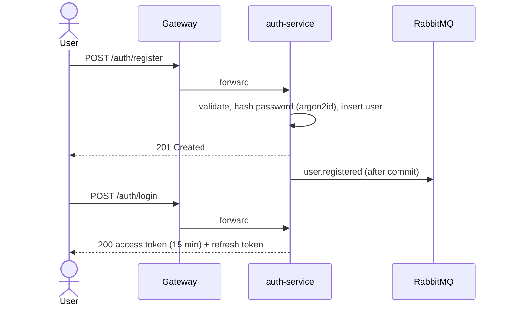
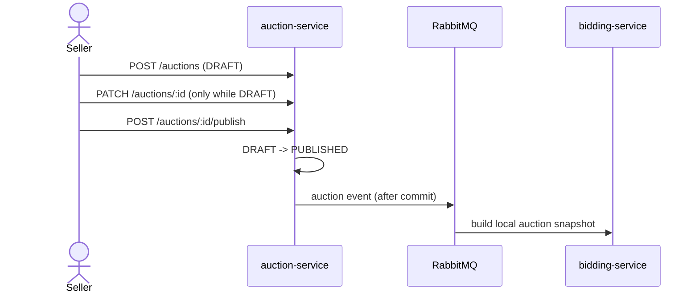
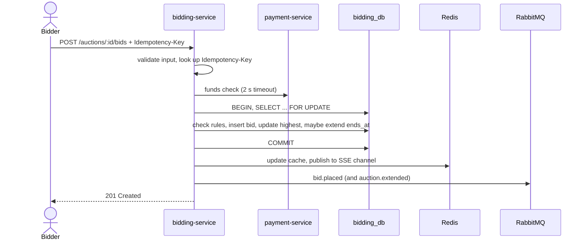
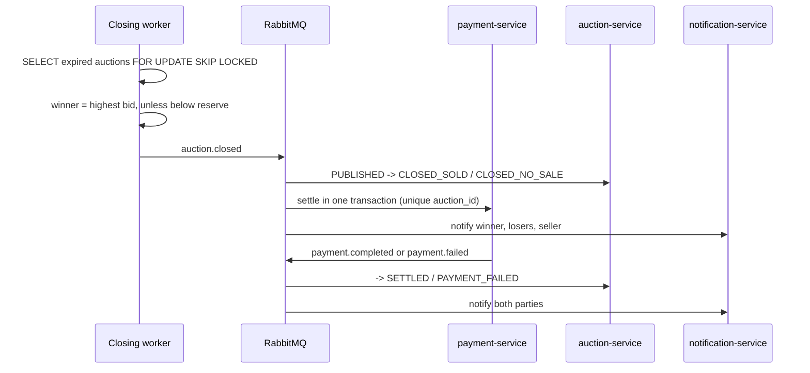

# Requirements: Online Auction Platform

**Owner:** Erona (task A-02) · **Reviewer:** Anesa · **Status:** draft for review · **Last updated:** 30.10.2026

This document covers section 2 of the course brief: the problem, goals, actors, functional and
non-functional requirements, data sources and main processes. Design details live in
`docs/architecture.md` (A-03) and the event contract in `docs/events.md` (B-01). Where this
document and `ROADMAP.md` disagree, `ROADMAP.md` wins and this file must be fixed.

---

## 1. Problem

Online auctions look simple, but they hide several hard problems:

- **Many people bid on the same item at the same moment.** If two requests read the same
  "current highest bid" and both succeed, the system accepts two conflicting bids, and the
  outcome depends on timing.
- **Sniping.** A bidder who waits until the last second leaves others no chance to answer.
- **Money must never be lost or created.** Closing an auction must move exactly the right amount
  from winner to seller and platform, exactly once, even if a message is delivered twice.
- **Everyone must see the same live state**, even when the bidding service runs as several
  replicas.

## 2. Goals

| ID  | Goal                                                     | Measured by                                                                                           |
| --- | -------------------------------------------------------- | ----------------------------------------------------------------------------------------------------- |
| G1  | Never accept two conflicting bids on one auction         | Concurrency test (B-13) and 500-bid k6 load test (B-19): exactly one winner, one consistent bid order |
| G2  | Give every bidder a fair chance at the end of an auction | Anti-sniping extension (FR-07)                                                                        |
| G3  | Settle every sold auction automatically, exactly once    | Idempotent settlement (FR-12), duplicate-event test (A-19)                                            |
| G4  | Show live bids to all viewers within about a second      | SSE across 2 replicas (FR-09)                                                                         |
| G5  | Be secure by default                                     | JWT RS256, RBAC, validation, parameterized SQL, security tests (A-23)                                 |
| G6  | Be reproducible and explainable                          | `docker compose up`, README, OpenAPI, tests with recorded results                                     |

## 3. Actors and roles

| Actor         | Description                                                                                                 | Role(s)                        |
| ------------- | ----------------------------------------------------------------------------------------------------------- | ------------------------------ |
| Visitor       | Not logged in. Can browse the catalog (whether visitors can also see live bidding data is open question Q3) | none                           |
| Bidder        | Registered user who bids and pays                                                                           | `BIDDER`                       |
| Seller        | Registered user who lists items. Usually also a bidder                                                      | `SELLER` (often with `BIDDER`) |
| Administrator | Seeded account that manages users, categories and auctions                                                  | `ADMIN`                        |
| System        | Background workers and event consumers (closing worker, settlement, notifications)                          | internal                       |

A user can hold several roles. Every new user starts as `BIDDER`; only an admin can grant `SELLER` (decision Q1). Roles are checked with `requireRole()`
middleware, and **ownership** (for example "this is my auction") is checked in the service layer.

### Permission matrix

| Action                                                | Visitor | Bidder | Seller               | Admin |
| ----------------------------------------------------- | ------- | ------ | -------------------- | ----- |
| Browse and search auctions, view details              | ✓       | ✓      | ✓                    | ✓     |
| View bid history and live state (FR-08, FR-09)        | Q3      | ✓      | ✓                    | ✓     |
| Register, log in                                      | ✓       |        |                      |       |
| Edit own profile                                      |         | ✓      | ✓                    | ✓     |
| Place a bid (not on own auction)                      |         | ✓      | ✓ (if also `BIDDER`) |       |
| Create, edit, publish, cancel, delete **own** auction |         |        | ✓                    |       |
| Cancel **any** auction                                |         |        |                      | ✓     |
| Wallet: balance, deposit, history                     |         | ✓      | ✓                    |       |
| Read own notifications                                |         | ✓      | ✓                    | ✓     |
| List users, ban/unban, change roles                   |         |        |                      | ✓     |
| Create categories, view all settlements               |         |        |                      | ✓     |

---

## 4. Functional requirements

Priority uses MoSCoW: **M** = must (core MVP), **S** = should, **C** = could (stretch).

| ID    | Requirement                    | Actor              | Priority | Tasks      |
| ----- | ------------------------------ | ------------------ | -------- | ---------- |
| FR-01 | Account and session management | Visitor, all users | M        | A-05, A-07 |
| FR-02 | Profile                        | All users          | M        | A-07       |
| FR-03 | User administration            | Admin              | M        | A-08       |
| FR-04 | Auction lifecycle for sellers  | Seller, Admin      | M        | A-11, A-13 |
| FR-05 | Catalog search and categories  | Everyone           | M        | A-12, A-14 |
| FR-06 | Place a bid                    | Bidder             | M        | B-06, B-10 |
| FR-07 | Anti-sniping extension         | System             | M        | B-07       |
| FR-08 | Bid history and live state     | Everyone, Bidder   | M        | B-08, B-09 |
| FR-09 | Live updates                   | Everyone           | M        | B-12, A-21 |
| FR-10 | Automatic closing and winner   | System             | M        | B-11       |
| FR-11 | Wallet                         | Bidder, Seller     | M        | A-16, A-17 |
| FR-12 | Automatic settlement           | System, Admin      | M        | A-18       |
| FR-13 | Notifications                  | All users          | M        | B-14, B-15 |
| FR-14 | Watchlist                      | Bidder             | C        | stretch    |

### FR-01 Account and session management

- A visitor registers with email, password and display name. The email is unique. The password is
  stored with argon2id, never in plain text. The new user always gets only the `BIDDER` role.
  The registration body has no roles field; a request that sends one is rejected with `400` (decision Q1).
- A user logs in with email and password and receives a 15-minute RS256 access token and a refresh
  token.
- The refresh token can be used once: each refresh returns a new pair and invalidates the old one
  (rotation). Refresh tokens are stored hashed.
- Logout invalidates the refresh token.
- Failed logins return a generic "invalid credentials" message, so nobody can find out which
  emails are registered. Banned users cannot log in or refresh.
- **Endpoints:** `POST /auth/register`, `/auth/login`, `/auth/refresh`, `/auth/logout`.

### FR-02 Profile

- A logged-in user reads and partially updates their own profile. Roles can never be changed
  here (only by an admin, FR-03). Only `displayName` can be changed
  (decision Q2): email, password, roles and status are not accepted, and any other field is
  rejected with `400`.
- **Endpoints:** `GET /users/me`, `PATCH /users/me`.

### FR-03 User administration

- An admin lists users with pagination, bans and unbans users, and changes their roles. This is
  the only way a user becomes a `SELLER` (decision Q1). Roles travel inside the access token, so
  a role change takes effect at the user's next login or token refresh (within 15 minutes).
- Registration publishes `user.registered` so other services can react (welcome notification).
- **Endpoints:** `GET /users`, `PATCH /users/:id/status`, `PATCH /users/:id/roles`.

### FR-04 Auction lifecycle for sellers

- A seller creates an auction as a `DRAFT` with title, description, category, image URLs,
  starting price, minimum increment, optional reserve price, start time and end time. Money is in
  integer cents with a currency.
- The seller can edit or delete the auction **only while it is `DRAFT`**.
- Publishing moves it to `PUBLISHED`. From then on, bidding-service accepts bids within
  `starts_at <= now < ends_at`.
- The seller can cancel **only before the first bid**. An admin can always cancel.
- Persisted states and allowed transitions (enforced in the service layer; anything else is
  `409`):

  | From                 | To                               | Trigger                                      |
  | -------------------- | -------------------------------- | -------------------------------------------- |
  | `DRAFT`              | `PUBLISHED`                      | Seller publishes                             |
  | `DRAFT`, `PUBLISHED` | `CANCELLED`                      | Seller (before first bid) or admin cancels   |
  | `PUBLISHED`          | `CLOSED_SOLD` / `CLOSED_NO_SALE` | `auction.closed` event                       |
  | `CLOSED_SOLD`        | `SETTLED` / `PAYMENT_FAILED`     | `payment.completed` / `payment.failed` event |

  "Upcoming" and "live" are not stored. They are derived from `starts_at` and `ends_at` in API
  responses.

- **Endpoints:** `POST /auctions`, `PATCH /auctions/:id`, `POST /auctions/:id/publish`,
  `POST /auctions/:id/cancel`, `DELETE /auctions/:id`.

### FR-05 Catalog search and categories

- Anyone lists auctions with full-text search (`q`), filters (category, status, price range),
  sorting and pagination (`?page=1&size=20`, size capped at 100).
- Anyone views auction details and lists categories. An admin creates categories.
- Drafts are not shown in the public catalog. Who can open a draft by ID is open question Q4.
- **Endpoints:** `GET /auctions`, `GET /auctions/:id`, `GET /categories`, `POST /categories`.

### FR-06 Place a bid

A bid is accepted only if **all** of these hold, checked inside one database transaction with a
row lock on the auction:

1. The auction is open and `starts_at <= now < ends_at`.
2. The amount is at least the current highest bid plus `min_increment` (or at least the starting
   price for the first bid).
3. The bidder is not the seller.
4. The bidder is not already the highest bidder.
5. The bidder's wallet balance covers the amount (checked with payment-service before the
   transaction, 2 s timeout; `503` if payment-service does not answer).

- The `Idempotency-Key` header makes retries safe: the same key returns the original result
  instead of placing a second bid.
- A rejected bid returns `409` with a clear code (for example `BID_TOO_LOW`); invalid input
  returns `400`.
- **Endpoint:** `POST /auctions/:id/bids`.

### FR-07 Anti-sniping extension

- If a bid is accepted within `SNIPE_WINDOW_SECONDS` (default 30) of `ends_at`, `ends_at` is
  extended by `SNIPE_EXTENSION_SECONDS`, at most `MAX_EXTENSIONS` times. All three are
  configurable through env variables.
- Each extension publishes `auction.extended`, so the catalog shows the new end time.

### FR-08 Bid history and live state

- Users read the bid history of an auction (paginated) and its current state (highest bid,
  number of bids, `ends_at`).
- A bidder lists their own bids across auctions.
- **Endpoints:** `GET /auctions/:id/bids`, `GET /auctions/:id/state`, `GET /bids/me`.

### FR-09 Live updates

- Viewers of an auction receive new bids, extensions and closing over Server-Sent Events, with
  a heartbeat, and the connection reconnects after a drop.
- Updates reach viewers connected to **either** bidding replica (Redis pub/sub fan-out).
- **Endpoint:** `GET /auctions/:id/stream`. (Whether this endpoint needs a token is open, see
  proposal 1 in `docs/design-proposals.md`.)

### FR-10 Automatic closing and winner

- A background worker closes auctions whose `ends_at` has passed, safely with 2 replicas
  (`FOR UPDATE SKIP LOCKED`).
- The highest bid wins. If there is no bid, or the highest bid is below the reserve price, the
  result is `CLOSED_NO_SALE`.
- The result is published as `auction.closed` (winner, amount, currency, seller).

### FR-11 Wallet

- Each user has one wallet with a balance in integer cents.
- A user views the balance, makes a **simulated** deposit (no real payment provider) and lists
  their transactions (paginated).
- An internal funds-check endpoint answers bidding-service. It is **never** reachable through
  the gateway.
- **Endpoints:** `GET /wallet/me`, `POST /wallet/deposit`, `GET /wallet/transactions`,
  `GET /internal/funds-check`.

### FR-12 Automatic settlement

- When `auction.closed` reports a sale, payment-service in **one** database transaction debits the
  winner, credits the seller the amount minus `PLATFORM_FEE_PERCENT` (default 5%), credits the
  platform account with the fee, and writes ledger entries.
- Settlement happens at most once per auction (unique `auction_id`). A replayed event changes
  nothing.
- If the winner's balance is too low, nothing is moved and `payment.failed` is published.
  Otherwise `payment.completed` is published.
- An admin lists all settlements.
- **Endpoint:** `GET /payments`.

### FR-13 Notifications

- Users receive in-app notifications for: welcome, outbid, auction won, auction lost, item sold,
  payment completed, payment failed.
- A user lists notifications (paginated), reads the unread count, marks one as read, or marks
  all as read.
- **Endpoints:** `GET /notifications`, `GET /notifications/unread-count`,
  `PATCH /notifications/:id/read`, `POST /notifications/read-all`.
- Email simulation through MailHog is stretch.

### FR-14 Watchlist (stretch)

- A bidder adds an auction to, and removes it from, a personal watchlist. Built only after the
  feature freeze, and only if time allows.
- **Endpoints:** `GET/POST/DELETE /watchlist`.

---

## 5. Non-functional requirements

The numbers below are **targets**. They become claims only after they are measured; results go in
`docs/performance-report.md` and `docs/test-report.md`.

### Security

| ID      | Requirement                                                                                                                                                                        |
| ------- | ---------------------------------------------------------------------------------------------------------------------------------------------------------------------------------- |
| NFR-S1  | All input (body, query, params, headers) is validated server-side with zod. Unknown fields are rejected where reasonable. Invalid input returns `400` in the standard error format |
| NFR-S2  | All SQL uses parameters (`$1, $2`). User input is never concatenated into SQL                                                                                                      |
| NFR-S3  | Passwords use argon2id. Refresh tokens are stored hashed and rotated on use                                                                                                        |
| NFR-S4  | Access tokens are RS256 JWTs valid for 15 minutes. Only auth-service has the private key; every other service verifies with the public key                                         |
| NFR-S5  | Every non-public endpoint requires a valid token (`401` otherwise). Wrong role or not the owner gives `403`                                                                        |
| NFR-S6  | HTTPS terminates at the Nginx gateway (self-signed certificate locally, documented as a limitation)                                                                                |
| NFR-S7  | The gateway applies rate limits (`429`). Login is throttled more strictly                                                                                                          |
| NFR-S8  | Every service sets security headers (helmet), a CORS allow-list and a body size limit                                                                                              |
| NFR-S9  | `/internal/*` endpoints are never routed by the gateway                                                                                                                            |
| NFR-S10 | Secrets exist only in env variables. `.env`, keys and certs are never committed                                                                                                    |
| NFR-S11 | Logs never contain passwords, tokens or card-like data                                                                                                                             |

### Performance

| ID     | Requirement (target)                                                                                                          | Verified by                    |
| ------ | ----------------------------------------------------------------------------------------------------------------------------- | ------------------------------ |
| NFR-P1 | 500 concurrent bids on one auction finish with **zero** inconsistent results: one bid order, one highest bid, no lost updates | k6 test (B-19) plus a DB check |
| NFR-P2 | p95 latency of `POST /auctions/:id/bids` under that load stays below 500 ms on the demo machine                               | k6 test (B-19)                 |
| NFR-P3 | p95 latency of `GET /auctions` (catalog browsing) stays below 200 ms at the read-heavy k6 load                                | k6 test (B-19)                 |
| NFR-P4 | The current highest bid is read from the Redis cache, and the report compares with and without the cache                      | k6 test (B-19)                 |
| NFR-P5 | A new bid reaches connected SSE viewers on both replicas within about 1 second                                                | Manual demo and test (B-12)    |

### Reliability

| ID     | Requirement                                                                                                             |
| ------ | ----------------------------------------------------------------------------------------------------------------------- |
| NFR-R1 | Event consumers are idempotent (unique constraint or processed-events table)                                            |
| NFR-R2 | A message that fails is retried 3 times, then moved to a dead-letter queue                                              |
| NFR-R3 | Events are published only after the database transaction commits                                                        |
| NFR-R4 | Bid retries with the same `Idempotency-Key` never create a second bid                                                   |
| NFR-R5 | Calls between services have timeouts (funds check: 2 s). An unavailable dependency gives `503`, never a hanging request |
| NFR-R6 | Every service exposes `/health`, and Docker Compose waits for healthy dependencies before starting a service            |
| NFR-R7 | The closing worker is safe to run on 2 replicas at once (no auction is closed twice)                                    |

### Maintainability

| ID     | Requirement                                                                                                                        |
| ------ | ---------------------------------------------------------------------------------------------------------------------------------- |
| NFR-M1 | Every service uses the same layers: routes, controllers, services (business logic), repositories (the only place with SQL)         |
| NFR-M2 | TypeScript `strict`, ESLint and Prettier pass in CI on every PR                                                                    |
| NFR-M3 | Every endpoint has tests for success, `400`, `401`, `403`, `404` and at least one edge case. Integration tests use a real Postgres |
| NFR-M4 | Every endpoint is documented in OpenAPI 3; every event payload in `docs/events.md`                                                 |
| NFR-M5 | Structured JSON logs (pino) carry a correlation ID across services                                                                 |
| NFR-M6 | Configuration comes only from env variables, all documented in `.env.example`; a service fails fast on a missing variable          |
| NFR-M7 | Each service owns its own database; no service reads another service's database                                                    |

### Portability and operability

| ID     | Requirement                                                                                                                      |
| ------ | -------------------------------------------------------------------------------------------------------------------------------- |
| NFR-O1 | The whole system starts with `docker compose up` plus the README steps, on Windows, macOS or Linux                               |
| NFR-O2 | Seed data is deterministic: an admin, a demo seller (`SELLER` + `BIDDER`), demo bidders and categories exist after a fresh start |
| NFR-O3 | Every service exposes `/metrics` for Prometheus                                                                                  |

---

## 6. Data sources

| Data                                       | Source                                                                         | Stored in                 |
| ------------------------------------------ | ------------------------------------------------------------------------------ | ------------------------- |
| Users, roles, refresh tokens               | User input (register, admin actions); seeded admin and demo users              | `auth_db`                 |
| Auctions, categories, image URLs           | Seller input; seeded categories and sample auctions                            | `auction_db`              |
| Bids, live auction state, idempotency keys | Bidder input; snapshot built from auction events                               | `bidding_db`, Redis cache |
| Wallets, ledger entries, settlements       | Simulated deposits; settlement after `auction.closed`; seeded platform account | `payment_db`              |
| Notifications                              | Built from events (`user.registered`, `bid.placed`, `auction.*`, `payment.*`)  | `notification_db`         |
| Configuration                              | Env variables (`.env`, documented in `.env.example`)                           | not stored                |

There are no external data sources or third-party APIs. Payments are simulated with internal
wallets, and images are referenced by URL (no file upload).

---

## 7. Main processes

### P1 Register and log in

### P2 Create and publish an auction

### P3 Place a bid

### P4 Close and settle

---

## 8. Constraints and assumptions

- Stack and architecture are fixed by `ROADMAP.md` (Node.js + TypeScript, Express, PostgreSQL,
  Redis, RabbitMQ, Nginx, React).
- The system runs locally with Docker Compose. There is no cloud deployment.
- Two students, hard deadline Mon 16.11.2026. The core MVP is in scope; stretch features are not
  built before the feature freeze (Wed 11.11.2026).
- All amounts are integer cents with a currency code.

## 9. Out of scope and known limitations

- **Out of scope (stretch):** watchlist, admin UI pages, email via MailHog, Grafana dashboard,
  circuit breaker, pre-bid fund holds, proxy bidding, buy-it-now, transactional outbox,
  second-chance offers, Kubernetes, real payment providers, OAuth / "Login with Google", image
  upload.
- **Known limitation:** funds are checked at bid time but not locked, so a user can bid beyond
  their balance across several auctions. Settlement then fails and `payment.failed` handles it.
- **Known limitation:** a banned user's access token stays valid until it expires (at most 15
  minutes).
- **Known limitation:** the TLS certificate is self-signed for local use.

## 10. Open questions

These are rules that `ROADMAP.md` does not decide. They are answered before the task that needs
them starts, and this document is updated.

| ID  | Question                                                                     | Options                                                                                                        | Decided by            | Needed for |
| --- | ---------------------------------------------------------------------------- | -------------------------------------------------------------------------------------------------------------- | --------------------- | ---------- |
| Q1  | How does a user become a `SELLER`?                                           | **Decided 30.10.2026:** only an admin grants it (`PATCH /users/:id/roles`). Registration always gives `BIDDER` | Erona                 | A-07, A-08 |
| Q2  | Which profile fields can `PATCH /users/me` change?                           | **Decided 30.10.2026:** `displayName` only. Email stays fixed, because it is the login identifier              | Erona                 | A-07       |
| Q3  | Do bid history, live state and the SSE stream need a token?                  | public read-only (like the catalog), or logged-in users only                                                   | Anesa (her endpoints) | B-08, B-12 |
| Q4  | Who can open a `DRAFT` auction by ID?                                        | its seller and admins (others get `404`), or its seller only                                                   | Erona                 | A-11       |
| Q5  | Are the performance targets in NFR-P2 and NFR-P3 right for the demo machine? | keep, or adjust after the first k6 run                                                                         | Anesa (B-19)          | B-19       |

- Design proposals 1, 2 and 4 in `docs/design-proposals.md` (public SSE stream, cancel through
  bidding-service, renaming `auction.created`) wait for Anesa's agreement. FR-04, FR-09 and the
  event names in P2 are updated once they are decided.
- Questions for the professor are listed in `ROADMAP.md` §8 (Kubernetes, required topics,
  frontend grading, AI disclosure format, documentation language).
